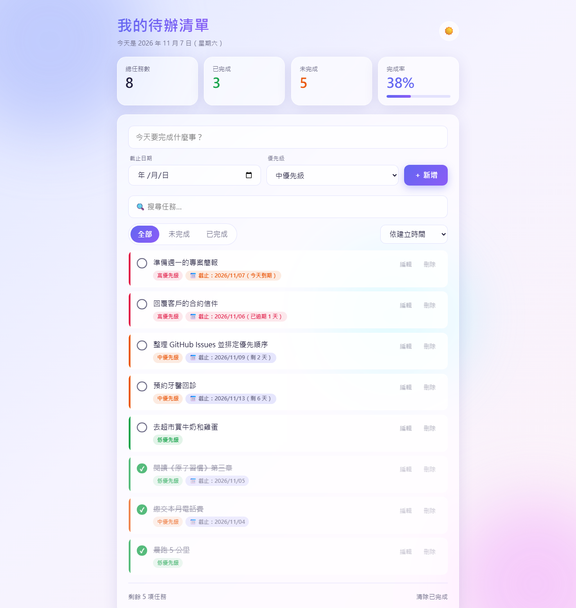
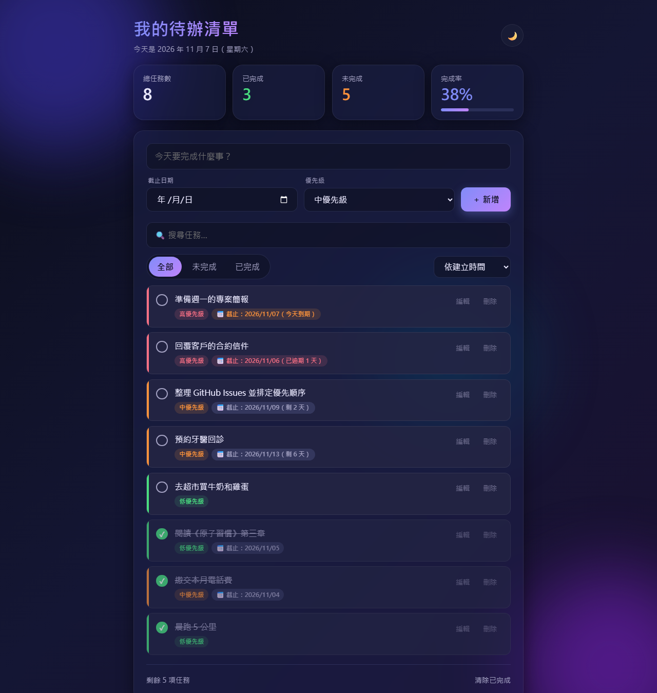
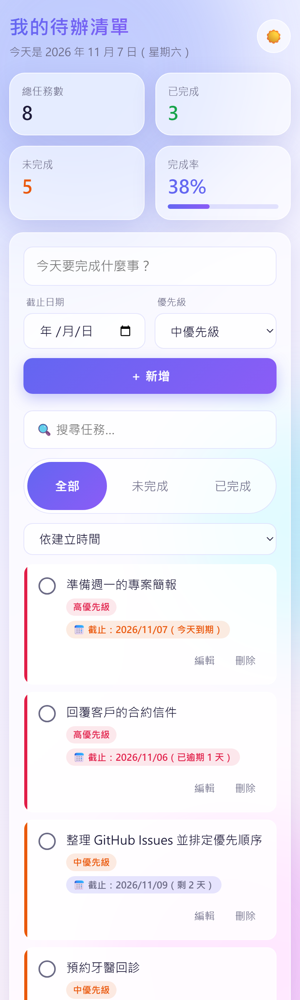
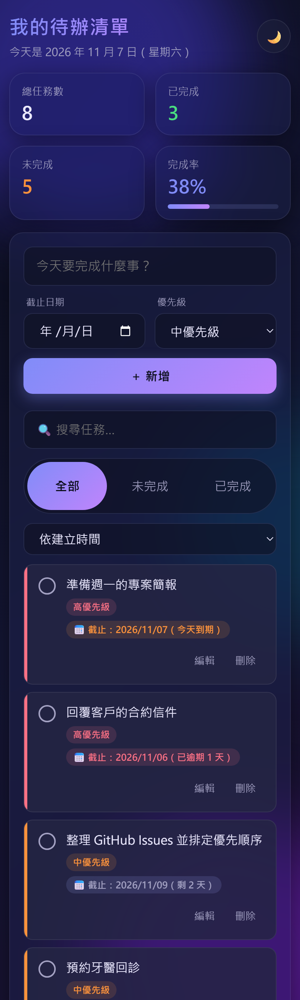

# Todo App（待辦清單）

一款輕巧、快速、可離線使用的現代化待辦清單應用程式，採用純 HTML、CSS 與 JavaScript 打造，無需安裝任何套件或建置工具。

## 功能特色

- ➕ **任務管理**：新增、編輯（點擊「編輯」或對任務文字連點兩下）、刪除任務，支援勾選完成與一鍵清除已完成項目。
- 📅 **任務截止日期**：
  - 新增與編輯任務時可選擇截止日期，顯示於任務下方。
  - **已逾期任務**以紅色醒目標示並顯示逾期天數。
  - **今天到期任務**以橘色醒目標示。
- 🏷️ **優先級管理**：
  - 支援 **高優先級（紅色）**、**中優先級（橘色）**、**低優先級（綠色）** 三種等級。
  - 可依「建立時間」、「優先級（高→低）」或「截止日期」排序。
- 📊 **統計儀表板**：
  - 即時顯示四張統計摘要卡：**總任務數**、**已完成**、**未完成**、**完成率 (%)** 與動態進度條。
- 🔍 **即時搜尋與篩選**：支援關鍵字即時搜尋，並可切換「全部 / 未完成 / 已完成」檢視模式。
- 🎨 **視覺與體驗優化**：
  - 現代化毛玻璃（Glassmorphism）介面設計、柔和光暈背景與流暢過場動畫。
  - 完整支援 **深色模式（Dark Mode）**，自動偵測系統偏好並記住使用者選擇。
  - 針對行動裝置最佳化的響應式版面與無障礙鍵盤操作（`Enter` 儲存、`Esc` 取消）。
- 📱 **PWA 支援**：
  - 內建 `manifest.json` 與 `service-worker.js`，支援安裝至手機或桌面主畫面（Add to Home Screen）及離線使用。
- 💾 **本機儲存與分頁同步**：資料自動保存在 `localStorage`，並於多個瀏覽器分頁間即時同步。

## 使用方式

### 1. 直接開啟或於本機啟動伺服器

可直接雙擊開啟 `index.html`，或於專案根目錄啟動本機靜態伺服器（建議以此方式測試完整 PWA 與 Service Worker 功能）：

```bash
python -m http.server 8000
```

接著在瀏覽器開啟 `http://localhost:8000`。

### 2. 操作說明

1. **新增任務**：在上方輸入框填寫任務內容，選擇「截止日期」與「優先級」，點擊「＋ 新增」或按 `Enter`。
2. **編輯任務**：點擊任務右側的「編輯」按鈕（或對任務文字連點兩下），修改內容、日期或優先級後按 `Enter` 或點擊「儲存」；按 `Esc` 可取消編輯。若將內容清空並儲存，該任務會自動刪除。
3. **搜尋、篩選與排序**：透過搜尋欄即時過濾關鍵字，使用「全部 / 未完成 / 已完成」切換狀態，或從下拉選單切換「依建立時間 / 依優先級 / 依截止日期」排序。
4. **安裝為應用程式（PWA）**：在支援的瀏覽器中點擊右上角「安裝 App」或從瀏覽器選單選擇「加到主畫面」，即可離線使用。

### 3. 執行自動化測試

```powershell
powershell -ExecutionPolicy Bypass -File tests\run-tests.ps1
```

## 專案截圖

### 桌面版（淺色 / 深色模式）

| 淺色模式 | 深色模式 |
| :---: | :---: |
|  |  |

### 行動裝置版（淺色 / 深色模式）

| 淺色模式 | 深色模式 |
| :---: | :---: |
|  |  |

## 線上展示

- 🔗 **線上體驗（GitHub Pages）**：https://tim941008.github.io/todo-app/
- 📦 **專案原始碼（GitHub Repository）**：https://github.com/tim941008/todo-app

## 技術架構

- **前端核心**：純原生 HTML5、CSS3（CSS Custom Properties、Grid、Flexbox、`backdrop-filter` 毛玻璃特效）、Vanilla JavaScript（ES5/ES6 相容、零外部相依套件）。
- **資料儲存**：瀏覽器 `localStorage`（含資料結構驗證、舊版資料自動相容升級與跨分頁 `storage` 事件同步）。
- **漸進式網路應用程式（PWA）**：
  - `manifest.json`：定義應用程式名稱、主題色、獨立視窗模式（`standalone`）與多尺寸圖示（192×192、512×512、Maskable 圖示）。
  - `service-worker.js`：預先快取 App Shell 靜態資源；同源請求採用「網路優先、離線回退快取（Network-first with Cache Fallback）」策略，兼顧版本即時更新與離線可用性。
- **自動化測試**：內建 120+ 項瀏覽器無頭測試（`tests/test.html` + `tests/run-tests.ps1`），涵蓋 CRUD、截止日期標示、優先級色彩與排序、統計儀表板、深色模式、響應式排版、XSS 防護與 PWA 設定。

## GitHub Pages

本專案透過 GitHub Pages 直接由 `main` 分支根目錄（`/`）自動部署：

1. 所有靜態資源與相對路徑皆針對子路徑（`/todo-app/`）與根目錄環境最佳化，並附帶 `.nojekyll` 確保檔案原樣發佈。
2. 當推送更新至 `main` 分支後，GitHub Pages 會自動建置並發佈最新版本至 https://tim941008.github.io/todo-app/。
